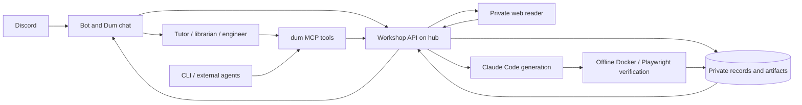

# dum-intern

- Dum is a learning companion: study an idea, try it, and teach Dum what you understood. It builds a working HTML/JavaScript creation from your teaching, then presents screenshots, code, and a flip-through explanation.
- Runs on hub, even when the laptop closes. Reach it through Discord, the private web reader, or the `dum` CLI and MCP tools.
- Each goal keeps its own context, study materials, teaching, attempts, and creations. Corrections make a new version without replacing the original.
- Teaching changes Dum's context, not the model's weights. Attempts and teaching are separate records, not proof of mastery. Agents need your approval to record your words, unless they quote your Discord teaching verbatim.
- Discord chat routes work to a tutor, librarian, or engineer with scoped tools. Optional services watch internship boards and stream hub's browser into Discord.

## How it works



- Builds must pass isolated interaction checks with observed output and real screenshots. Failed builds stay failed; generated JavaScript never runs in the host's Node process.
- The workshop owns its state; Discord and MCP use its API. Finished demos run in sandboxed frames on a separate artifact origin.
- Hub's BrowserOS screen can be watched or taken over through private noVNC. Run `dum live pause` before showing anything private and `dum live resume` afterward.

## Run locally

Requires Linux with `/proc`, Node 24, `flock`, Docker, and an authenticated Claude Code CLI. The service user needs Docker access; builds use CLI authentication, not a separate model API key.

```sh
npm ci
claude auth status
docker build -f src/workshop/publisher.Dockerfile -t dum-workshop-browser:1 .
npm start
```

Open `http://127.0.0.1:8770/`. Artifacts use `http://127.0.0.1:8771/`. `npm run dev` watches backend source.

- State lives in `~/.local/state/dum-workshop` by default; override with `DUM_WORKSHOP_HOME`. Only one process may own a workshop home.
- For private-network access, set `DUM_WORKSHOP_HOST` and a long random `DUM_WORKSHOP_TOKEN`. Non-loopback startup requires a token. Never expose the workshop or artifact ports through a public tunnel; artifact links are not authenticated.
- Builds send goal context, teaching, and correction data to the CLI provider. Verification runs offline in Docker. Keep secrets out of context.
- User-service definitions are in [`deploy/`](deploy/). The workshop reads `~/.config/dum-workshop/environment`; the Discord bot reads `~/.config/dum-discord/environment` and a separate token file. Keep credential files mode 600.

## Use it

- In Discord, start with `/dum goal` in the lobby. Each goal gets a private channel. Mention Dum to chat, or use `/dum teach`, `/dum tried`, `/dum build`, `/dum correct`, `/dum progress`, and `/dum schedule`.
- `dum status` shows the overview. `dum mcp install` registers the tools with hub's agents; `dum mcp laptop` prints the Mac setup.
- Hub and laptop agents exchange scoped tasks through `~/handoff`. Teaching and attempt requests from agents arrive in Discord for approval.
- [dumintern.com](https://dumintern.com/) is the public product site. [notes.ryhub.dev](https://notes.ryhub.dev/) contains explicitly published notes; private teaching, attempts, and context are never automatically exported.

## Development

```sh
npm run typecheck
npm test
```

- `src/workshop`: state, API, reader, generation, and verification.
- `src/discord`, `src/mcp`, `src/cli.ts`: chat, approvals, notifications, and agent access.
- `src/context`, `src/shared`: context sync, shared approvals, and handoffs.
- `src/live`, `src/internship`: screen streaming and internship watch.
- `src/site`, `src/public`: public site and static hosting.
- [Product plan](docs/workshop-plan.md) · [Demo walkthrough](docs/demo.md) · [Notes publishing guide](.claude/skills/dum-publish/SKILL.md)
