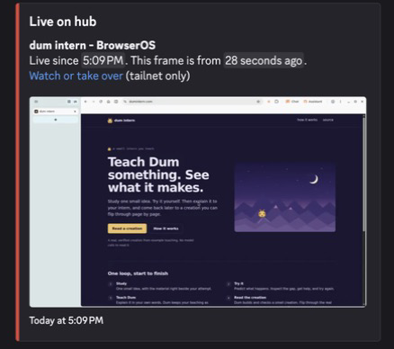

# dum-intern

Study a small idea, try it, and teach Dum what you understood. Dum builds a real little creation from that teaching and prepares a flip-through walkthrough: screenshots, actual code, and an explanation from your intern. Reading it does not call a model.

**Watch it work.** Agents on hub drive a real browser on a screen nobody sits at, and that screen streams into a private Discord channel while they work: a fresh screenshot every few seconds, the page they're on, and a link to take over. When the screen goes quiet the message closes with its last frame, so the channel doubles as a log. [How it works](#hubs-screen-live-in-discord).



[The product plan](docs/workshop-plan.md) records the learning loop and design decisions. This replaces the earlier desktop app and skill-gated automation stack; that implementation remains in Git history.

## What works

- Private goals, editable global/per-goal context, immutable teaching records, and labelled attempt/progress history.
- Study materials and graded reasoning exercises for loops, conditions, and combining them. Other teaching can be recorded, but this is not an all-subject curriculum.
- Manual builds or an optional interval schedule. The hub process keeps working when the browser or laptop closes.
- A bounded, interactive HTML/JavaScript creation generated through the authenticated Claude Code CLI. The host validates its source without running generated JavaScript.
- Offline Docker/Playwright verification of clicks, inputs, exact observed output, and real screenshots. Failed builds stay failed; no fabricated presentation or automatic retry.
- A fixed manga reader with Dum/Wizard glyphs, keyboard navigation, saved page position, and version links such as `/#job=<job-id>`.
- Corrections create another verified version without replacing the original.
- Hub's screen, live in Discord. Agents work in BrowserOS on a virtual display, `#hub-live` shows it while it changes, noVNC lets you take over, and `dum live pause` keeps anything private off Discord.

Teaching affects Dum's persistent context and creation choices. It does not retrain the model. Graded answers and self-reports are recorded separately; neither a polished creation nor a single explanation establishes mastery.

## Run the workshop

Use Linux with `/proc`, Node 24, util-linux `flock` on PATH, Docker, and a logged-in Claude Code CLI with access to the selected model. The service user needs Docker access. Builds use your CLI authentication; no separate model API key is required by this implementation.

Generation sends the queued goal and global context, teaching records, and any correction text to the configured CLI provider. Corrections also send the verified parent HTML and presentation. Generation requires provider access; verification runs offline in Docker. The private reader can run the finished demo in a sandboxed frame on the separate artifact origin. Generated JavaScript never runs in the host's Node process.

```sh
npm ci
claude auth status
docker build -f src/workshop/publisher.Dockerfile -t dum-workshop-browser:1 .
npm start
```

Open `http://127.0.0.1:8770/`. Generated artifacts use the separate origin `http://127.0.0.1:8771/` and are embedded in sandboxed frames. Do not put those ports behind a public tunnel: artifact links are not authenticated.

For access over a trusted private network, set `DUM_WORKSHOP_HOST` to the host's private address and `DUM_WORKSHOP_TOKEN` to a long random secret. Non-loopback startup requires a token. Enter that secret in the workshop login; do not commit it.

| Environment variable | Default / purpose |
| --- | --- |
| `DUM_WORKSHOP_HOME` | `~/.local/state/dum-workshop`; private records and artifacts |
| `DUM_WORKSHOP_HOST` | `127.0.0.1` |
| `DUM_WORKSHOP_PORT` | `8770`; private UI/API |
| `DUM_WORKSHOP_ARTIFACT_PORT` | `8771`; separate artifact origin |
| `DUM_WORKSHOP_TOKEN` | Required for non-loopback access and notes publication, including on loopback |
| `DUM_CLAUDE_EXECUTABLE` | `claude`; override for systemd PATH |
| `DUM_WORKSHOP_MODEL` | `fable` |
| `DUM_WORKSHOP_EFFORT` | `medium` |
| `DUM_WORKSHOP_BROWSER_IMAGE` | `dum-workshop-browser:1` |

Persisted state belongs outside the checkout. Only one process may own a workshop home. Stop the existing service before starting a second instance against the same home. Interrupted jobs are requeued using a fresh artifact directory after restart.

Owner acquisition, stale-owner recovery, and release are serialized with an OS lock on a stable private guard file. Never unlink or replace that guard while the workshop is running. Durable writes enforce the 256 MiB state ceiling and reserve space for bounded job failures; a result that cannot fit becomes a visible failed job without replacing earlier history.

## Run on hub

`deploy/dum-workshop.service` is a user service. Set its working directory for your checkout and keep a mode-600 environment file at `~/.config/dum-workshop/environment`. Include a PATH containing Node, Claude, and Docker.

```sh
install -D -m 644 deploy/dum-workshop.service ~/.config/systemd/user/dum-workshop.service
systemctl --user daemon-reload
systemctl --user enable --now dum-workshop.service
journalctl --user -u dum-workshop.service
```

To use the workshop without the token from your own machine, add `DUM_WORKSHOP_LOCAL_OPEN=1` to the environment file. The app and artifact servers then also listen on hub's `127.0.0.1`, and requests there addressed to `localhost` need no token. The Tailscale address keeps its login. Writes still need the page's own Origin, and the local door can't publish notes. From a laptop:

```sh
ssh -N -L 8770:127.0.0.1:8770 -L 8771:127.0.0.1:8771 hub   # then open http://localhost:8770
```

Anything else running on hub can reach that door without a token too, so leave it off on a shared machine.

With `DUM_WORKSHOP_TAILNET_OPEN=1`, your own Tailscale devices skip the token at the Tailscale address too. A device counts only if `tailscale whois` says it belongs to the same user as hub. Shared-in devices still log in, and the notes rules and Origin rules above still apply.

Enable user lingering if the process must continue after logout: `loginctl enable-linger "$USER"`. Browser closure does not stop systemd.

## Discord

`src/discord/bot.ts` is a second user service. It gives each goal its own private channel under a "Dum goals" category, so the goal's requests, teaching and creations live together. It reads and writes through the workshop API and never touches the store directly. Hub stays the record and Discord points back to it.

`#dum` is the lobby. Start a goal there with `/dum goal`, which opens a form for the title and ambition. The bot makes its channel right away. Goals made on the web or from the terminal get a channel within a few seconds too, and a goal channel someone deletes is made again.

Inside a goal's channel, every command applies to that goal:

- `/dum teach concept:` opens a form for your explanation, in your own words. `/dum tried concept: helped:` reports an attempt the same way. Both are recorded as yours.
- `/dum study material:` shows a study page privately. `/dum studied concept:` and `/dum revisit concept: note:` record what you did.
- `/dum context` edits the goal's own context in a form, or adds to it once it's longer than a Discord form holds.
- `/dum build`, `/dum correct creation: correction:` (the original is kept), and `/dum schedule minutes:` (leave it empty to turn it off).
- `/dum progress` and `/dum status` show this goal's records and creations. In the lobby, `/dum status` covers every goal and `/dum goals` lists the channels.

Each creation gets one silent status message in its goal's channel, edited through its real states: queued, generating and verifying, ready, or failed. A finished creation pings you once with up to four panel screenshots and a link to the presentation. A failure pings you with a link only, and the error text stays on hub. Reads are private to you, and changes like teaching show up in the channel as its record. Only the server owner can use any of it, and only in Dum's own channels.

The bot connects out over the gateway, so it needs no public endpoint. `~/.local/state/dum-discord/` holds `ledger.json` (what was delivered where) and `channels.json` (which channel is whose). Both are written only after Discord accepts a change, so a restart picks up where it left off. If channels can't be made, delivery carries on in the lobby and the log says why.

Keep the bot token in a mode-600 file and the IDs in `~/.config/dum-discord/environment`:

```sh
DUM_DISCORD_TOKEN_FILE=/home/you/.config/dum-discord/token
DUM_DISCORD_APPLICATION_ID=...
DUM_DISCORD_GUILD_ID=...
DUM_DISCORD_CHANNEL_ID=...   # the lobby
DUM_DISCORD_OWNER_ID=...
```

```sh
install -D -m 644 deploy/dum-discord.service ~/.config/systemd/user/dum-discord.service
systemctl --user daemon-reload
systemctl --user enable --now dum-discord.service
journalctl --user -u dum-discord.service
```

Invite the bot with View Channel, Send Messages, Embed Links, Attach Files, Read Message History, Manage Channels, and application commands (permissions `117776`).

## Talk to Dum from anywhere

Dum lives on hub and stays up when the laptop is closed. You can reach it four ways, and they all work on the same goals and records.

**Discord.** Mention the bot in `#dum` or a goal's channel and just talk: "what did I teach you about loops?", "build something", "teach you: a loop repeats the same steps for each item". Each message runs Claude Code on hub as Dum and its team (below). Dum answers each mention right in the channel, as a reply to that message, and works on several at once (four by default, `DUM_CHAT_PARALLEL`), even in the same channel, so a slow request never holds up the next. Each channel keeps one ongoing conversation. A new request branches it from the latest finished answer (`--fork-session`), so requests running at the same time never share a session. Each turn runs as its own systemd user unit and is kept on disk under `~/.local/state/dum/turns/`, so restarting the bot, even when Dum's engineer does it after changing Dum's own code, doesn't lose an answer: the bot delivers it when it's back. The engineer takes `dum lock take <name>` before changing Dum's code, so two requests never edit it at once. When a change works, it ships with `dum ship "what changed"`: typecheck and tests again, a scan that refuses credential-shaped values, one commit as hub-ry, and a fast-forward push to `main`. It never force-pushes, and never lists an AI as an author or co-author. The slash commands still work too, and `#dum-now` shows what Dum is doing, what's queued, and what's waiting on you.

**Attachments.** Screenshots and files you attach to a message that mentions Dum come with it, even with no text, and so do the ones on your own message you reply to. The bot downloads them right away, only from Discord's CDN, at most 25 MB each and 50 MB per message, into `~/.local/state/dum/attachments/<message id>/` (mode 600, never executed, pruned after 30 days). PNG, JPEG, GIF and WebP images Claude can take go into the turn as images Dum sees directly; every attachment is also listed in the prompt with its name, type, size and path, so a PDF can go to the librarian. Turns read their input from `input.jsonl` in the turn's folder (`claude -p --input-format stream-json`).

**A small team behind the chat.** The Dum you talk to has no shell. It understands you, records your exact words, and routes everything else to a specialist with only the tools that job needs. The tutor explains and makes practice problems; it reads materials and the web but can't record anything as yours. The engineer has the shell: it gives Dum new abilities in its own repo, runs tests, restarts Dum safely, sets up timers, works in your other projects, and can hand coding to Codex. The librarian turns lecture notes, PDFs and assignments into a goal's context, labelled as imported material and never as your teaching. Claude Code's built-in general-purpose agents are denied, so the shell exists only in the engineer. `src/discord/agents.ts` defines the team, and tests check that Dum has no shell, that no specialist can record your words, and that every tool an agent names exists. A reply says which specialists helped, and `~/.local/state/dum/chat/audit.jsonl` records who used which tools on every turn, without message text.

**MCP.** `dum mcp` is an MCP server on stdio. It reaches the workshop API and the `~/handoff` exchange, and nothing listens on the network. `dum mcp install` registers it with Codex, omp and Claude Code on hub. `dum mcp laptop` prints the setup for Claude on the Mac, which launches `ssh hub ~/.local/bin/dum mcp`. The tools cover goals, context, study material, teaching, attempts, progress, builds, corrections, creations, schedules and handoffs. `dum status` prints the same overview an agent sees first. omp also gets a second server, `dum codex-mcp`. Its one tool, `codex`, hands a self-contained task to the Codex agent in a folder (`codex exec`, sandboxed to that folder by default) and returns Codex's final answer, so omp can delegate to Codex mid-conversation.

**Your words stay yours.** An agent can't record anything as your own teaching or attempt. Those requests show up in the goal's channel as a card with **Yes, these are my words** and **Decline**, and only an approval writes them. There's one exception. If you teach Dum in its own Discord chat and the text it records appears word for word in your message, it's recorded right away, with a quote posted in the channel. Anything Dum rephrased still gets a card.

**The loop between hub and the laptop.** Agents hand work to each other through `~/handoff`, in the format its README defines. An agent on hub calls `handoff_create` for `laptop` when something needs the Mac: its apps, its browser, its screen. Discord pings you. The Claude app on the laptop runs a scheduled pickup every 30 minutes while it's awake. It does the task within the task's stated scope, then writes `result.md` back through the same tools. The agent on hub picks the result up with `handoff_wait`. It works in the other direction too: Claude on the laptop can hand work to `hub` for omp or Codex. Handoffs never carry secrets; a write with a credential-looking line is refused.

## Hub's screen, live in Discord

Hub has a screen nobody sits at: Xvfb on display `:99` with openbox, and BrowserOS running there as the agents' browser. Any agent on hub can drive that browser through its MCP server (`browseros-hub`, `http://127.0.0.1:9200/mcp`). You watch or take over in noVNC from any tailnet device at `http://100.109.151.100:6080/vnc.html`.

A bot can't go live in a voice channel, so `dum-live` streams the screen another way. It grabs an 80x50 grayscale thumbnail every two seconds. When enough of it changes, it posts one silent message in a private `#hub-live` channel and swaps that message's screenshot every five seconds while the screen keeps moving. Each thumbnail pixel averages a 20x20 patch and has to move by 16 levels, at least three of them at once, so a blinking cursor or a clock doesn't count. After three quiet minutes the message is marked ended and keeps its last frame. Each stretch of work gets its own message, so the channel doubles as a log of what agents did on hub. The message names the focused window, which is usually the page BrowserOS has open, and links the noVNC page.

Before anything private goes on that screen (an address, a birthday, personal answers on a form), the agent runs `dum live pause`. That stops streaming within two seconds and marks the message paused. `dum live pause 30` lasts half an hour, `dum live pause 0` lasts until `dum live resume`, and a plain pause is an hour. `dum live status` says which.

The screen itself is five user units in `deploy/`: Xvfb, openbox, x11vnc on localhost, noVNC on the tailnet address (edit `hub-screen-web.service` for another machine), and BrowserOS with its own profile. BrowserOS binds its agent ports (9000, 9001, 9100, 9200) on every interface, and hub's wired side sits on a campus network, so `hub-browseros-guard` drops those ports unless the traffic comes over loopback or Tailscale.

```sh
sudo apt install xvfb openbox x11vnc novnc python3-websockify ffmpeg xdotool   # plus BrowserOS's .deb
for u in hub-screen hub-screen-wm hub-screen-vnc hub-screen-web browseros-hub; do
  install -D -m 644 deploy/$u.service ~/.config/systemd/user/$u.service
done
systemctl --user daemon-reload
systemctl --user enable --now hub-screen hub-screen-wm hub-screen-vnc hub-screen-web browseros-hub
sudo install -D -m 644 deploy/hub-browseros-guard.nft /etc/nftables.d/hub-browseros-guard.nft
sudo install -m 644 deploy/hub-browseros-guard.service /etc/systemd/system/
sudo systemctl enable --now hub-browseros-guard
claude mcp add --transport http -s user browseros-hub http://127.0.0.1:9200/mcp
```

Then the stream:

```sh
install -D -m 644 deploy/dum-live.service ~/.config/systemd/user/dum-live.service
systemctl --user daemon-reload
systemctl --user enable --now dum-live.service
journalctl --user -u dum-live.service
```

It uses the bot's token and guild from `~/.config/dum-discord/environment`, makes `#hub-live` under the "Dum goals" category, and keeps its channel and current message in `~/.local/state/dum-discord/live.json`. A message left live by a restart is marked ended when the service comes back. `src/live/live.ts` holds the change detection, the live and idle rules and the message text, all tested without a screen or Discord.

## Root context

The workshop's root context, which every build sees, comes from files on hub. Each goal still keeps its own. `~/context/dum-root.txt` lists the source files in priority order (home-relative globs, `!` to exclude). `src/context/root-context.ts` packs whole files into the workshop's 24,000-character limit and lists the rest by name.

A goal's own context holds up to 48,000 characters (about 12-15k tokens). It goes whole into every build for that goal and comes back to agents in `dum_goal`, which has to fit Claude Code's 25,000-token limit on a tool result, so the cap is a model budget rather than a storage one. It is one number for every goal, set in `src/workshop/validate.ts`. The root context stays at 24,000 because every build of every goal carries it. `dum_set_context` reports how full a goal's context is, warns past 80%, and refuses anything over the limit with the sizes involved and how to condense: rewrite it with mode `replace`, keeping Ryan's words verbatim, and move long detail into files under `~/dum-library/<goal-name>/`. Lines that look like credentials are dropped before anything leaves hub, and nothing is written when the result hasn't changed.

```sh
npm run root-context -- --show   # preview, sends nothing
install -m 644 deploy/dum-root-context.service deploy/dum-root-context.timer ~/.config/systemd/user/
systemctl --user daemon-reload
systemctl --user enable --now dum-root-context.timer   # every 5 minutes
```

Root context is sent to the model with every build, so put only what you're fine sharing with the provider in those files.

### Shared context

Between the root (every goal) and a goal's own context there is shared context: a named block of text linked to several goals, like one about Ryan's career that software, gpa and internship all use. Each linked goal's rendered context includes it, labelled with the other goals that share it, so builds, `dum_goal` and chat all see it, and it's written once instead of copied into each goal. Dum manages it with `dum_set_shared_context` (text appends by default; `goals`, `add_goals` and `remove_goals` set the links), `dum_shared_contexts` and `dum_delete_shared_context`; the workshop serves it at `/api/shared-contexts`. A goal carries at most 16,000 characters from all its shared blocks together, on top of its own 48,000, so `dum_goal` still fits Claude Code's tool-result limit. Blocks live in the workshop state file next to the goals.

## Internship watch

`src/internship` reads public Summer 2027 boards and posts to the internship goal's channel. It only reads boards and posts links. Nothing in it opens, fills in or submits an application.

- Sources: SimplifyJobs' `listings.json` (dev branch; Software and Data/AI/ML sections, open postings only) and the speedyapply 2027 SWE README. If speedyapply can't be read, the scan carries on with Simplify alone.
- `scan` runs every 4 hours, 7am to 11pm Indiana time. The first run posts a ranked top 10 and marks everything else seen. After that it pings only when a new posting fits.
- `nag` runs at 8:30am. It posts the count of good open fits he hasn't applied to, the time-sensitive tracker items and a number to apply to today, at most once a day.
- Ranking comes from his city tiers, logistics, systems and recsys roles, and the untouched target list in `~/internship/applications/tracker.md`. Companies already in the tracker are left out, or marked if they rejected him. Defense companies never appear. The tracker is only read, never written.
- The channel comes from the bot's `channels.json` and the token from the file named in `~/.config/dum-discord/environment`. Each posted message is read back from Discord before it counts.
- State lives in `~/.local/state/dum-internship/`: `scan.json` (seen postings) and `nag.json`. Deleting `scan.json` makes the next scan a first run again.

```sh
npm run internship -- scan --dry-run   # or nag; prints instead of posting
install -m 644 deploy/dum-internship-*.service deploy/dum-internship-*.timer ~/.config/systemd/user/
systemctl --user daemon-reload
systemctl --user enable --now dum-internship-scan.timer dum-internship-nag.timer
systemctl --user disable --now dum-internship-scan.timer dum-internship-nag.timer   # to stop it
```

## Purdue Brightspace

Dum reads Ryan's Purdue Brightspace (courses, due dates, grades, assignments, announcements, syllabi) through [brightspace-mcp-server](https://github.com/RohanMuppa/brightspace-mcp-server) by Rohan Muppa (MIT). It's pinned to an exact version in `~/opt/brightspace-mcp`, never `npx ...@latest`. Every chat turn starts it as a third MCP server once its launcher exists (`brightspaceServer` in `src/discord/chat.ts`; override the path with `DUM_BRIGHTSPACE_MCP`). Dum, the tutor and the librarian get its reading tools. Nobody gets `sign_out` or classmates' rosters and emails, and only the librarian can save files from it.

Sign-in is a headless Chromium going through Purdue's Microsoft login. The server keeps the password, the authenticator setup key and its session key in the Secret Service through `secret-tool`. Hub has no desktop to unlock a keyring, so `gnome-keyring-daemon.service` gets a drop-in that unlocks the `login` keyring at start from a random key in `~/.config/gnome-keyring-headless/unlock-key` (mode 600). D-Bus activation goes through that unit, so there is only ever the one, unlocked daemon. That keeps them out of plain files, but anyone who can read files as ryanhubbart can read the keyring too. Ryan chose fully automatic sign-in: hub holds his password and his authenticator (TOTP) setup key, so on hub the two factors are one. The key still stops anyone who has only the password.

```sh
sudo apt-get install -y --no-install-recommends gnome-keyring libsecret-tools
sudo update-alternatives --set pinentry /usr/bin/pinentry-curses   # gnome-keyring pulls in pinentry-gnome3
install -d -m 700 ~/.config/gnome-keyring-headless
[ -e ~/.config/gnome-keyring-headless/unlock-key ] || (umask 077; head -c 48 /dev/urandom | base64 -w0 > ~/.config/gnome-keyring-headless/unlock-key)
install -D -m 644 deploy/brightspace/gnome-keyring-headless-unlock.conf ~/.config/systemd/user/gnome-keyring-daemon.service.d/headless-unlock.conf
install -D -m 644 -t ~/.local/share/dbus-1/services deploy/brightspace/org.freedesktop.secrets.service deploy/brightspace/org.gnome.keyring.service
systemctl --user daemon-reload && systemctl --user add-wants default.target gnome-keyring-daemon.service
busctl --user call org.freedesktop.DBus /org/freedesktop/DBus org.freedesktop.DBus ReloadConfig
systemctl --user restart gnome-keyring-daemon.service

install -D -m 644 -t ~/opt/brightspace-mcp deploy/brightspace/package.json deploy/brightspace/package-lock.json
install -D -m 755 -t ~/opt/brightspace-mcp/bin deploy/brightspace/brightspace deploy/brightspace/setup.mjs
(cd ~/opt/brightspace-mcp && npm ci && ./node_modules/.bin/playwright install chromium && sudo ./node_modules/.bin/playwright install-deps chromium)
```

Then Ryan sets up sign-in once, himself, in a terminal on hub: `~/opt/brightspace-mcp/bin/brightspace setup`. That's `deploy/brightspace/setup.mjs`, not the package's wizard, which offers to register the unpinned `npx ...@latest` with Claude Code and Codex. First he adds an authenticator at https://mysignins.microsoft.com/security-info (Microsoft Authenticator, then "I want to use a different authenticator app", then "Can't scan image?" for the secret key). The script asks for his username, his password (hidden, twice) and that setup key (hidden). It can show the current 6-digit code so he can finish Microsoft's enrollment without a phone app. It saves them with the package's own `saveSecureConfig`, signs in once with no way to type a code (so only the automatic path can pass), and asks the server for his courses as proof. Run again, Enter keeps what's saved. After that, the server signs in again by itself whenever the session runs out: the password, then the code it generates. If Microsoft ever wants the phone instead, the tool response carries the number and Dum passes it on in Discord. `brightspace doctor` checks the setup, and `brightspace auth --logout` forgets the session.

To upgrade, change the exact version in `deploy/brightspace/package.json`, check the new release against its GitHub source, then reinstall as above and run `npm test`. The test pins the server's tool list.

## Verify

```sh
npm run typecheck
npm test
```

`npm run dev` watches backend source. The deterministic tests cover persistence, progress evidence, scheduling, revision history, restart recovery, and filesystem boundaries. Full creation verification additionally requires the real CLI and Docker; it is not a mocked CI model call.

The backend has been exercised through the actual browser with original and corrected shelter creations, exact boundary-case output, saved reader position, authentication, process restart, and a build completed after closing the browser. The public product site and notes reader have also been exercised on desktop/mobile; note creation and revision use the authenticated CLI.

## Public site and learning journal

`https://dumintern.com/` is a separate static product site. `/demo/` contains six real screenshots and matching excerpts from a verified example, explicitly not a learner-progress record. It exposes no workshop login or API.

```sh
bash deploy/deploy.sh
```

This installs public files in `/opt/dum-public` and runs the hardened `dum-public.service` on loopback port 8070. The earlier public service is stopped and disabled; existing unrelated stored data is not deleted.

`https://notes.ryhub.dev/` is a plain, read-only topic/deck journal through the existing Cloudflare Tunnel. After the public-site deployment above, run `bash deploy/deploy-notes.sh` to provision `/var/lib/dum-notes` for the hub's UID-1000 publisher and install the notes service. Add `DUM_PUBLIC_NOTES_DIR=/var/lib/dum-notes` to the private environment file, with authentication configured as above. Restart the workshop to generate the empty public index, then rerun the script to start the notes service:

```sh
bash deploy/deploy-notes.sh
npm run note -- create --title "Title" --topic "Topic" --file pages.json
npm run note -- revise --id <note-id> --title "Title" --topic "Topic" --file pages.json
npm run note -- list
```

The notes service reuses the same static server on loopback port 8071. Cloudflare's `notes.ryhub.dev` ingress points there, not to the private API. Public GET/HEAD requests can read pages; public mutations are rejected.

`pages.json` is an object with `pages`, an array of `{ "heading": "...", "text": "...", "code": "optional" }`, and optional `links`, an array of `{ "label": "...", "url": "https://..." }`. The CLI reads the private environment file literally, authenticates to the workshop, and never writes public files directly. Public content is explicitly selected; no context, attempts, or teaching history is automatically exported. Private note revisions are immutable; only their escaped HTML projection is served publicly.

Publication is bounded at 5,000 notes and 100,000 revisions per note. A capacity rejection writes no new revision and leaves the existing records and public projection readable.

The reusable [dum-publish skill](.claude/skills/dum-publish/SKILL.md) documents the complete payload, API, hosting, and privacy rules.

## Files

- `src/workshop`: private runtime, materials, API, reader, generation, and isolated verifier.
- `src/discord`: goal channels, delivery, slash commands, chat, approvals and the `#dum-now` board, on top of the workshop API.
- `src/mcp` and `src/cli.ts`: the `dum` command and its MCP server. `bin/dum` is what agents launch.
- `src/client`: the one client for the workshop API. `src/shared`: the approval queue and the `~/handoff` exchange.
- `src/context`: root context sync from files on hub.
- `src/internship`: the internship board watcher and morning nag.
- `src/live`: hub's virtual screen streamed into `#hub-live`, and `dum live pause`.
- `src/art`: authored Dum and Wizard glyphs.
- `src/site`: public product site and an explicitly labelled example presentation.
- `src/public`: static-only public hosting; no workshop credentials or private APIs.

See [CONTRIBUTING.md](CONTRIBUTING.md) for contribution conventions.
