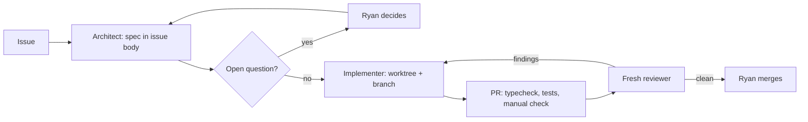

# Building Dum with agents

How coding agents work on this repo. The in-product agents (tutor, librarian, engineer, mailcode) are a different thing; see `src/discord/agents.ts`.

Every agent reads [CLAUDE.md](../CLAUDE.md) first. It holds the invariants; this page holds the process.

## Roles

Model tiers follow [the product plan](workshop-plan.md#delivery-order-and-public-learning-log): GPT-6.1 Sol at high reasoning for design, Claude Fable at medium effort for implementation, Claude Opus 5.5 at low effort for automation. Report the model that actually ran; never substitute silently.

| Role | Tier | Does | Does not |
|---|---|---|---|
| Architect | high reasoning | Turns an issue into a spec in the issue body: problem with file:line anchors, decision, files to touch, interfaces, a mechanical acceptance (named test, typecheck, an observed command), out of scope, risks, size. Flags product choices as open questions for Ryan. | Write code. |
| Implementer | Fable, medium | One issue, one branch, one worktree. Reads the spec, CLAUDE.md and the matching skill in `.claude/skills/`. Runs `npm run typecheck` and `npm test`, does the spec's manual check, opens a PR that links the issue. | Touch `deploy/`, env or credential files, another module's internals, or anything outside the spec. Restart services. Run `dum live`. |
| Reviewer | any tier, fresh instance | Reads the spec, CLAUDE.md and the diff cold. Reruns typecheck and tests in its own checkout. Reports findings on the PR, each tied to a spec line or an invariant. | Fix things itself, or see the implementer's conversation. |

The reviewer being fresh matters more than its model. An implementer grading its own work is where agent bugs survive.

## One issue, end to end



```sh
git fetch origin main
git worktree add -b issue-N ../dum-intern-wt/issue-N origin/main
cd ../dum-intern-wt/issue-N && npm ci
# ...work...
npm run typecheck && npm test
git push -u origin issue-N && gh pr create --fill --body "Closes #N"
```

Agents open PRs. Ryan merges. Nothing an agent does lands on `main` unattended. Commits are Ryan's identity (`hub-ry`): no AI author, no `Co-Authored-By`, no force push.

## Parallel work

Modules are split along ownership: the workshop owns state, Discord and MCP go through its API (`src/client/workshop.ts`). That lets independent issues run as concurrent implementers, one worktree each.

- Parallel only when the specs share no file. The spec's "Size" line says which issues it can run beside.
- Anything that changes the workshop API (`src/workshop/server.ts` routes, `src/client/workshop.ts`, `src/workshop/validate.ts` record shapes) is serial.
- Each implementer gets the spec, CLAUDE.md and the skill. Not the whole conversation.
- Tests are already isolated per process (`src/shared/test-isolation.ts`), so parallel `npm test` runs don't collide with each other or with the live service.

## What runs on hub unattended

Both are read-only toward the deployed checkout, the workshop home and GitHub. They run in their own clone of `main` under `~/.local/state/dum-nightly/repo`.

| Unit | When | Does |
|---|---|---|
| `dum-nightly.timer` | 03:30 Indiana | Fetches main, `npm ci`, typecheck, tests, builds the verifier image as `dum-workshop-browser:nightly` (never the `:1` tag the service runs). One line to the lobby; mentions Ryan only on failure. Log in `~/.local/state/dum-nightly/logs/`. No model calls. |
| `dum-triage.timer` | Sunday 04:30 Indiana | A low-effort model reads the open issues against main, flags stale or vague specs, runs only the test files issues name, drafts issues from TODOs. Writes `~/.local/state/dum-nightly/triage/<date>.md` and posts its path. Files, edits and comments on nothing. |

Install once merged:

```sh
cp deploy/dum-nightly.{service,timer} deploy/dum-triage.{service,timer} ~/.config/systemd/user/
systemctl --user daemon-reload
systemctl --user enable --now dum-nightly.timer dum-triage.timer
```

Nothing scheduled writes to `main` or to `~/.config/dum-*`. Keep it that way: an unattended writer is where the owner lock and the credentials become real risks.

## Hard lines for dev agents

- Never read `~/.config/dum-workshop/environment`, `~/.config/dum-discord/environment`, the Discord token file, the gh token, or the Brightspace/Outlook keyring session. Don't print environment variables.
- Never run `dum live *`.
- Only the Docker verifier executes generated creations, in tests too.
- The approval flow for Ryan's words stays as it is. No fixture, helper or flag records teaching or attempts without it.
- Anything that starts the workshop outside `npm test` sets `DUM_WORKSHOP_HOME` to a temp dir and uses free ports (CLAUDE.md, "Running anything locally").
